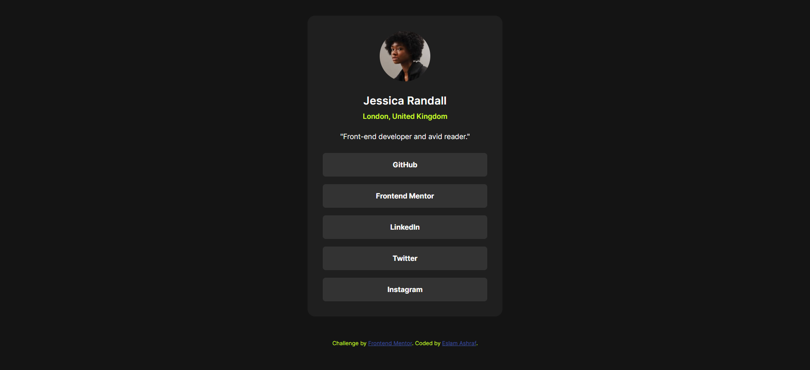

# Frontend Mentor - Social links profile solution

This is a solution to the [Social links profile challenge on Frontend Mentor](https://www.frontendmentor.io/challenges/social-links-profile-UG32l9m6dQ). Frontend Mentor challenges help you improve your coding skills by building realistic projects.

## Table of contents

- [Overview](#overview)
  - [The challenge](#the-challenge)
  - [Screenshot](#screenshot)
  - [Links](#links)
- [My process](#my-process)
  - [Built with](#built-with)
  - [What I learned](#what-i-learned)
  - [Continued development](#continued-development)
  - [AI Collaboration](#ai-collaboration)
- [Author](#author)

## Overview

### The challenge

Users should be able to:

- See hover and focus states for all interactive elements on the page

### Screenshot



### Links

- Solution URL: [https://github.com/e5lama5hraf/social-links-profile](https://github.com/e5lama5hraf/social-links-profile)
- Live Site URL: [https://e5lama5hraf.github.io/social-links-profile/](https://e5lama5hraf.github.io/social-links-profile/)

## My process

### Built with

- Semantic HTML5 markup
- CSS custom properties
- Flexbox
- CSS Grid (to center the card)
- Mobile-first workflow
- Self-hosted variable font ([Inter](https://fonts.google.com/specimen/Inter))

### What I learned

- **Making the whole button clickable:** I set the links to `display: block` with padding, so the entire button area is clickable, not just the text.

```css
.social-links li a {
  display: block;
  padding: 15px;
  transition: 0.3s;
}
```

- **Rounded corners with hover backgrounds:** adding `overflow: hidden` to the `li` keeps the hover background inside the rounded corners.

- **Centering with Grid:** `display: grid` with `place-items: center` on the `body` centers the card in the viewport with just two lines.

- **Design tokens with CSS custom properties:** I stored the colors in variables in `:root`, which makes changing the theme easy.

- **Self-hosting fonts:** I used `@font-face` to load Inter locally instead of relying on an external service.

### Continued development

- Write better focus styles with `:focus-visible` so keyboard users get a clear indicator.
- Use more accessible, descriptive alt text and ARIA labels where needed.
- Get more comfortable with responsive layouts beyond a single breakpoint.

### AI Collaboration

I used Claude to review my code and help me polish this README. I wrote the HTML and CSS myself, then used it to catch mistakes and improve the documentation.

## Author

- GitHub - [@e5lama5hraf](https://github.com/e5lama5hraf)
